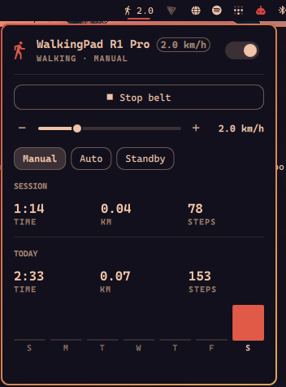

# Omarchy WalkingPad

Control a KingSmith **WalkingPad** treadmill over Bluetooth from the Omarchy
bar: start and stop the belt, change speed and mode, and keep an eye on your
steps. No vendor app, no account, no network access.



## Features

- **Bar icon** that shows your speed (or steps) while you walk
- **Popup** with start/stop, a speed slider and ± buttons, Manual / Auto /
  Standby mode, session stats, today's totals and a 7-day step chart
- **Mouse and keyboard control**: scroll on the icon to change speed, or drive
  the whole popup from the keyboard
- **Keybinding commands** (`omarchy-shell walkingpad toggle`, `faster`,
  `speed 3.5`, …) so you can control the belt without opening anything
- **One Bluetooth link for every monitor**: all bars share a single connection
- **Local history**: daily totals stay on your machine, last 30 days

## Supported pads

| Status | Models |
|---|---|
| ✅ Tested | **WalkingPad R1 Pro** |
| 🟡 Should work, untested | A1, A1 Pro, R1, C1, C2 |
| ❌ Not supported | Newer models that only speak the standard fitness-machine profile (FTMS), such as the Z1 |

The plugin finds pads by their Bluetooth protocol (service `FE00`), not by
model name, so any WalkingPad that uses that protocol should work. If you try it
on another model, please [open an issue](https://github.com/kristijanzrno/omarchy-walkingpad/issues)
saying whether it worked.

## Requirements

- Omarchy with the omarchy-shell bar
- A Bluetooth adapter that's switched on

Nothing else to install. The Bluetooth bridge uses the system Python with
`python-gobject` and BlueZ, both part of every Omarchy install. It runs with
`/usr/bin/python3` on purpose, so a mise or pyenv Python on your `PATH` doesn't
get in the way.

No pairing is needed. On first run the plugin scans for the pad, then
remembers its address. Nothing runs as root, and no packages or services are
installed for you: the bridge is a child process of the shell and exits with it.

## Install

```bash
omarchy plugin add https://github.com/kristijanzrno/omarchy-walkingpad.git --enable
```

The widget lands in the right side of the bar. Move it with
`omarchy bar move io.github.kristijanzrno.walkingpad --section center`.

## Remove

```bash
omarchy plugin remove io.github.kristijanzrno.walkingpad
```

This disables the widget, disconnects from the pad and deletes the plugin.
Your saved pad and step history are kept in
`~/.local/state/omarchy-walkingpad/` so a reinstall picks them up. Delete that
folder if you want them gone.

## Update

```bash
omarchy plugin update io.github.kristijanzrno.walkingpad
omarchy-shell walkingpad restart
```

The Bluetooth service is kept loaded, so a plugin reload never drops your
connection mid-walk. The second command restarts just the bridge so it picks up
the new version. If an update changes the service itself, the release notes will
say to run `omarchy restart shell` instead.

## Using it

| Where | Input | Action |
|---|---|---|
| Bar | left click | open popup |
| Bar | right click | start / stop belt |
| Bar | middle click | connect / disconnect |
| Bar | scroll | faster / slower (while walking) |
| Popup | `space` / `s` / `enter` | start / stop belt |
| Popup | `←` `→` / `-` `+` | slower / faster |
| Popup | `m` | cycle Manual → Auto → Standby |
| Popup | `c` | connect / disconnect |

When starting, the pad switches itself to Manual mode, counts down 3 seconds,
then the plugin sets the **Speed after starting** (default 2.0 km/h).

**The phone app:** a WalkingPad accepts one Bluetooth connection at a time. To
use the KS Fit app, flip the switch in the popup header (or middle-click the
icon) to disconnect, or set **Connect automatically** to Off.

## Keybindings

The shared service answers on IPC target `walkingpad`:

```bash
omarchy-shell walkingpad toggle       # start / stop
omarchy-shell walkingpad start
omarchy-shell walkingpad stop
omarchy-shell walkingpad faster
omarchy-shell walkingpad slower
omarchy-shell walkingpad speed 3.5
omarchy-shell walkingpad mode auto    # manual | auto | standby
omarchy-shell walkingpad connect
omarchy-shell walkingpad disconnect
omarchy-shell walkingpad restart      # restart the Bluetooth bridge
omarchy-shell walkingpad status       # JSON
omarchy-shell io.github.kristijanzrno.walkingpad toggle  # open / close the popup
```

For example, in `~/.config/hypr/bindings.lua`:

```lua
o.bind("SUPER + ALT + W", "WalkingPad start/stop", "omarchy-shell walkingpad toggle")
o.bind("SUPER + ALT + EQUAL", "WalkingPad faster", "omarchy-shell walkingpad faster")
o.bind("SUPER + ALT + MINUS", "WalkingPad slower", "omarchy-shell walkingpad slower")
```

## Settings

Set these in the bar widget's settings, or on its entry in
`~/.config/omarchy/shell.json`:

| Key | Values | Default |
|---|---|---|
| `barLabel` | `speed`, `steps`, `today`, `icon` | `speed` |
| `maxSpeed` | `6.0`, `8.0`, `10.0` (R1 Pro: 6 walking, 10 with the handrail up) | `6.0` |
| `speedStep` | `0.1`, `0.2`, `0.5`, `1.0` | `0.5` |
| `startSpeed` | `keep`, `1.0` … `4.0` | `2.0` |
| `autoConnect` | `on`, `off` | `on` |

## How it works

```
Panel.qml (one per bar) ──reads──▶ Service.qml (one per shell)
                                      │ stdin: commands  ▲ stdout: JSON state
                                      ▼                  │
                                   walkingpad.py ── D-Bus (python-gobject) ── BlueZ ── BLE ── pad
```

`walkingpad.py` connects through BlueZ, subscribes to characteristic `FE01`,
and asks for stats once a second by writing to `FE02`. Frames are
`F7 <cmd…> <sum> FD` going out and `F8 A2 …` status frames coming back.
Commands are spaced 0.7 s apart because the pad drops them when sent faster.

Debug the bridge on its own (stop the plugin first, since only one client
can hold the pad):

```bash
/usr/bin/python3 walkingpad.py --verbose
# then type: start 2.5 | speed 3 | stop | mode auto | quit
```

Protocol details come from the
[ph4-walkingpad](https://github.com/ph4r05/ph4-walkingpad) project.

## Other WalkingPad plugins

Two other Omarchy plugins work with KingSmith pads. Both are worth a look:

- [shllg/omarchy-walkingpad-control](https://github.com/shllg/omarchy-walkingpad-control):
  belt control with a full history and analysis window. Developed on a C2.
- [msegoviadev/omarchy-walkingpad](https://github.com/msegoviadev/omarchy-walkingpad):
  step tracking with daily goals and a GitHub-style history graph. Supports
  more models, including FTMS pads.

This plugin focuses on controlling the pad: mode switching, keybindings, scroll
to change speed, and configurable start and top speeds. It's tested on the R1 Pro.

## License

[MIT](LICENSE)
